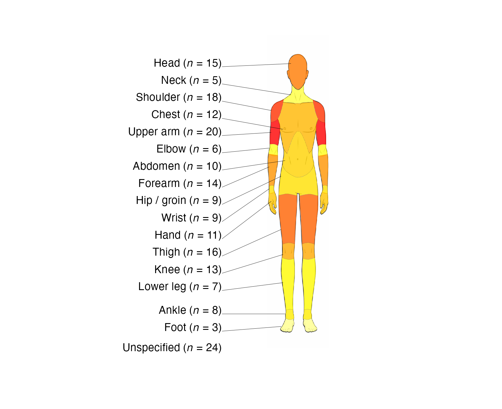
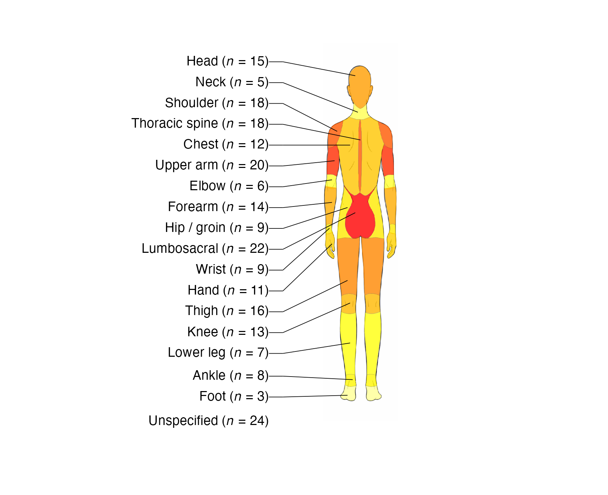
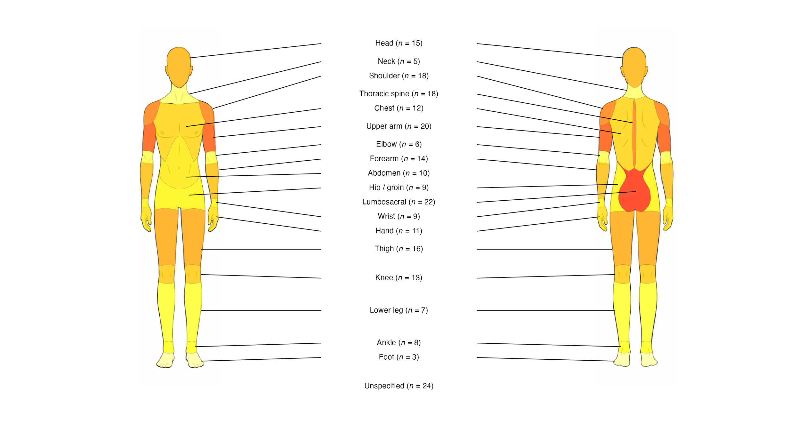
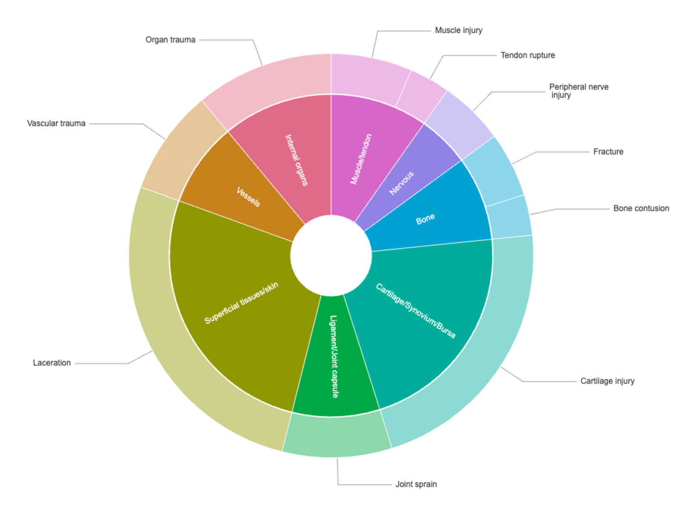

---
format:
  gfm:
    default-image-extension: ""
    wrap: none
---

<!-- README.md is generated from README.qmd. Please edit that file -->

```{r}
#| include: false
knitr::opts_chunk$set(
  collapse = TRUE,
  comment = "#>",
  fig.path = "man/figures/README-",
  out.width = "100%"
)
```

# spinviz 

<!-- badges: start -->
[](https://cran.r-project.org/package=spinviz)
[](https://lifecycle.r-lib.org/articles/stages.html#experimental)
[](https://github.com/bnqcasimiro/spinviz/actions/workflows/R-CMD-check.yaml)
[](https://github.com/bnqcasimiro/spinviz/actions/workflows/rhub.yaml)
[](https://app.codecov.io/gh/bnqcasimiro/spinviz)
[](https://cran.r-project.org/package=spinviz)
[](https://bnqcasimiro.github.io/spinviz/)
<!-- badges: end -->

`spinviz` is an `R` package for visualising **sports injury frequency data**. It renders **anatomical heatmaps** (front/back, male/female body models) and **interactive tissue-type to pathology-type sunburst diagrams**. Toggle labels and values, customise colour palettes and legends, and export publication-ready **PNG, JPG or PDF** figures.

The main function, `plot_heatmap()`, colours anatomical regions by injury frequency and can render **front**, **back**, or **both** views, using **male** or **female** body templates. `plot_sunburst()` renders tissue types on an inner ring and pathologies on an outer ring. Built-in taxonomies (`body_categories`, `injury_categories`), one-call wrappers, and `save_diagram()` for correct-aspect-ratio export are also included.

Full documentation, tutorials, and a function reference live on the [pkgdown site](https://bnqcasimiro.github.io/spinviz/).

## Installation

As this package is not currently on CRAN, install from GitHub:

```r
# install.packages("pak")
pak::pak("bnqcasimiro/spinviz")
```

## Quick examples

**Heatmap diagram**

```{r}
#| label: example-heatmap
#| eval: false
plot_heatmap(df, "boxing", "front", sex = "male", show_scale = FALSE)
```

<details>
<summary><b><code>Example Diagrams</code></b></summary>

| Front (Male) | Back (Male) | Both Views (Male) |
|---|---|---|
| {height="300"} | {height="300"} | {height="300"} |

</details>

**Sunburst diagram**

```{r}
#| label: example-sunburst
#| eval: false
plot_sunburst(df, "boxing", plot_title = "Boxing Injuries")
```

<details>
<summary><b><code>Example Diagram</code></b></summary>

| Tissue/Pathology Sunburst |
|---|
| {height="400"} |

</details>

## Learn more

- [Get started](https://bnqcasimiro.github.io/spinviz/articles/spinviz.html) — data format and worked examples
- [Importing data from a CSV file](https://bnqcasimiro.github.io/spinviz/articles/importing-csv-data.html) — template-based CSV workflow
- [Customising and saving diagrams](https://bnqcasimiro.github.io/spinviz/articles/customisation.html) — palettes, display options, and file export
- [Function reference](https://bnqcasimiro.github.io/spinviz/reference/)

## Dependencies

Key packages used:

- Data wrangling: `dplyr`, `tidyr`, `rlang`, `stringr`
- SVG handling: `xml2`
- Iteration/utilities: `purrr`, `magrittr`
- Raster + plotting: `magick`, `ggplot2`, `grDevices`
- Combining plots: `patchwork`
- Interactive sunbursts: `echarts4r`, `htmlwidgets`
- Optional (sunburst file export only): `chromote`, `base64enc`

## Acknowledgements

`spinviz` builds on the foundations laid by the [`injvis`](https://github.com/alexandraD03/injvis-R-Package) and `olympicinjuRies` R packages. We thank Alexander Brinkman, Alexandra Dooley, Andisheh Saffarian, Brice Thu, and Utsav Chadha (`injvis`), and Zoe Remo, Brayden Smith, Govardhan Bharadwaj, Katja Amet, Kyle Mcnicholas, and Zachary Carr (`olympicinjuRies`), for their work on those projects, which provided the groundwork for this package.
